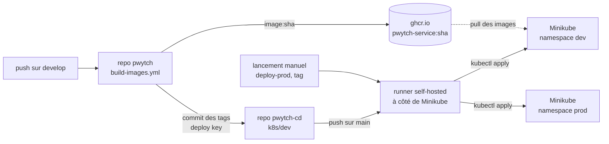
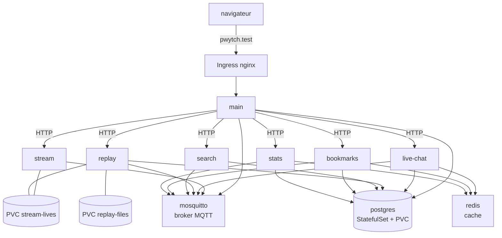

# pwytch-cd

Repo de **déploiement** (CD) de Pwytch : uniquement les fichiers Kubernetes et les workflows qui les appliquent sur Minikube. Le code des 7 services et la CI sont dans [Bilnaa/pwytch](https://github.com/Bilnaa/pwytch).

Sommaire : [Architecture](#architecture) · [Prérequis](#prérequis-et-cluster) · [Déployer](#déployer) · [Vérifier](#vérifier-les-ressources) · [Accéder](#accéder-aux-applications) · [ArgoCD](#argocd) · [Choix et justifications](#choix-et-justifications)

## Architecture

### Chaîne CI/CD



1. Un push sur `develop` (repo CI) construit les 7 images et les publie sur ghcr.io, taguées avec le sha complet du commit.
2. Le job `update-cd` écrit ces tags dans `k8s/dev` de ce repo (un commit `deploy(dev): images <sha7>`).
3. Ce commit sur `main` déclenche `deploy-dev`, qui tourne sur le runner self-hosted et fait `kubectl apply -f k8s/dev`.
4. La prod ne bouge qu'à la main : `deploy-prod` avec un tag (promotion) ou sans (réapplique `k8s/prod`).

### Un environnement (namespace `dev` ou `prod`)

Les deux namespaces ont les mêmes manifests (seuls le namespace et `FRONTEND_ORIGIN` changent).



Les flèches viennent du ConfigMap `pwytch-config` et des variables des Deployments (`stream` n'a pas de base ; `main` n'utilise pas redis). Seul `main` est exposé.

| Brique | Rôle | Type |
|---|---|---|
| `main` | seule porte d'entrée : sert le front et `/api`, relaie vers les 6 autres | Deployment + Service |
| `stream`, `live-chat`, `replay`, `search`, `bookmarks`, `stats` | services métier, port 8000, un Service chacun | Deployment + Service |
| `postgres` | une instance, 6 bases créées par `init.sql` (une par service) | StatefulSet + PVC 1 Gi |
| `redis` | cache | Deployment, sans volume |
| `mosquitto` (Service `mqtt`) | broker MQTT, messages en direct | Deployment, sans volume |
| `stream-lives`, `replay-files` | fichiers des lives (écrits par stream, lus par replay) et des replays | PVC 1 Gi |
| Ingress `pwytch` | `pwytch.test` / `pwytch.prd` vers `main:8000`, en https (Secret `pwytch-tls`) | Ingress (nginx) |

Chaque service a trois probes HTTP (startup, readiness, liveness), voir [Vérifier](#vérifier-les-ressources).

### Organisation du repo

```
k8s/dev/, k8s/prod/   manifests numérotés (00 namespace, 1x infra, 2x services, 30 ingress)
.github/workflows/deploy-dev.yml    push sur main touchant k8s/dev -> kubectl apply (automatique)
.github/workflows/deploy-prod.yml   lancement manuel, input optionnel `tag` (promotion)
charts/pwytch/                      chart Helm de Pwytch (remplacera k8s/dev et k8s/prod), values-dev.yaml et values-prod.yaml
```

Les manifests de `k8s/` sont en YAML simple. Le chart `charts/pwytch` les reprend petit à petit : il contient la base (values, labels communs, namespace de la release), l'infra stateful (postgres, redis, mosquitto), le ConfigMap `pwytch-config` et un Deployment + un Service pour chacun des 7 services (template `services.yaml`, une entrée par service dans `services:` de `values.yaml` : replicas, port, ressources, image).

- Infra stateful : postgres (StatefulSet, volume de `postgres.storage`, une base par service créée au premier démarrage, identifiants depuis le Secret `postgres-credentials`), redis et mosquitto (Deployment + Service, configuration de mosquitto dans un ConfigMap). Les Services gardent les noms `postgres`, `redis` et `mqtt` utilisés dans les URLs.

- Configuration non secrète : `config.data` dans les values. Chaque service ne reçoit que les clés listées dans son `config`. Changer une valeur change l'annotation `checksum/config` des services qui la lisent : leurs pods redémarrent avec la nouvelle valeur, sans rebuild d'image.
- Secrets : le chart ne contient aucune valeur secrète, il référence par leur nom les Secrets créés à la main (`secrets.databaseUrls`, `secrets.jwt`, voir [Secrets](#secrets-détail-de-létape-2)). Chaque service ne reçoit que les siens : `DATABASE_URL` depuis sa clé (`databaseUrlKey`), `JWT_SECRET_KEY` pour `main` seulement.
- Image : `<registry>/<repositoryPrefix><service>:<image.tag>`, toujours un sha complet. Un service peut avoir son propre `image.tag` (ou `image.repository`). Le namespace se choisit avec `-n` ; le chart ne le crée pas (il existe déjà, sinon `--create-namespace`).
- Probes : startup, readiness et liveness sur la route `probePath` de chaque service (`/api` pour main, `/health` pour les autres). Délais et seuils dans `probes` des values.
- Volumes : `volumes` crée un PVC par entrée (`stream-lives`, `replay-files`, taille dans les values). stream écrit les lives, replay les lit en lecture seule et écrit ses replays. Chaque volume est monté au chemin de la clé du ConfigMap que lit l'appli (`LIVES_DIR`, `REPLAYS_DIR`). Les PVC sont gardés par `helm uninstall`.
- Autoscaling de main : `services.main.autoscaling.enabled=true` ajoute un HPA sur le CPU (min, max, seuil dans les values) et retire `replicas` du Deployment. Il faut metrics-server (`minikube addons enable metrics-server`).
- Ingress : `ingress` des values, vers `services.<ingress.service>` (main). `ingress.host` est donné par environnement (`pwytch.test`, `pwytch.prd`). `ingress.tls` active https avec le Secret `pwytch-tls` créé à la main ; `FRONTEND_ORIGIN` doit suivre (`https://<host>`).

Le label `environment` vient du namespace (`-n dev` ou `-n prod`). `image.tag` (sha complet du repo CI) n'a pas de valeur par défaut : chaque environnement donne le sien. `values.schema.json` vérifie les values (dev/prod, sha de 40 caractères).

Un fichier de values par environnement, `values-dev.yaml` et `values-prod.yaml`, ne surcharge que ce qui change : `environment`, `image.tag`, `FRONTEND_ORIGIN` et `ingress.host`. Ce sont des copies de `k8s/dev` et `k8s/prod` : jusqu'à la bascule sur le chart, un changement se fait aux deux endroits. Installer un fichier dans le mauvais namespace (`-n dev -f values-prod.yaml`) échoue.

```bash
helm lint charts/pwytch -n dev -f charts/pwytch/values-dev.yaml
helm template pwytch charts/pwytch -n dev -f charts/pwytch/values-dev.yaml
helm template pwytch charts/pwytch -n prod -f charts/pwytch/values-prod.yaml
```

## Prérequis et cluster

- Une machine Linux ou macOS avec `docker`, `kubectl` et `minikube`.
- Un cluster Minikube avec l'addon ingress :

```bash
minikube start --driver=docker
minikube addons enable ingress
kubectl get nodes        # le noeud doit être Ready
```

(`minikube start` et `addons enable` ne sont pas rejoués ici, le cluster existait déjà ; l'état a été vérifié avec `minikube status` et `kubectl get nodes`.)

- Un runner GitHub self-hosted enregistré sur ce repo (Settings > Actions > Runners) avec le label `pwytch-vm`, installé sur la même machine que Minikube, avec `kubectl` configuré sur le cluster. Il tourne comme service systemd (`actions.runner.Bilnaa-pwytch-cd.*.service`). Le workflow le cible avec `runs-on: [self-hosted, pwytch-vm]`.
- Dans les repos GitHub : le repo CI a le secret `CD_DEPLOY_KEY` (clé privée dont la clé publique est une deploy key avec écriture sur ce repo).

## Déployer

### 1. Namespaces

```bash
kubectl apply -f k8s/dev/00-namespace.yaml -f k8s/prod/00-namespace.yaml
```

À faire avant les secrets, qui vivent dans un namespace.

### 2. Secrets (une fois par namespace)

Aucun secret n'est dans Git : voir [Secrets](#secrets-détail-de-létape-2) plus bas. Sans eux, les pods des services restent en erreur.

### 3. Dev : automatique

Un push sur `main` qui touche `k8s/dev/**` lance `deploy-dev` : `kubectl apply -f k8s/dev`, attente du rollout de chaque Deployment et StatefulSet, puis `kubectl get pods`. En pratique, on ne le fait pas à la main : c'est la CI du repo `pwytch` qui commit les nouveaux tags. Premier déploiement ou relance : onglet Actions > deploy-dev > Run workflow, ou en local depuis la machine du cluster : `kubectl apply -f k8s/dev`.

### 4. Prod : manuel, par promotion

Actions > deploy-prod > Run workflow, avec en entrée le sha complet (40 caractères) d'un tag déjà testé en dev, par exemple celui du dernier commit `deploy(dev): images <sha7>` (le sha complet est dans les `image:` de `k8s/dev`). Le workflow valide le tag, remplace les images dans `k8s/prod`, commit `deploy(prod): promote <sha7>`, applique et attend le rollout. Sans tag, il réapplique `k8s/prod` tel quel. Avec la CLI GitHub : `gh workflow run deploy-prod.yml --repo Bilnaa/pwytch-cd -f tag=<sha>` (commande non lancée ici pour ne pas modifier la prod).

Changer une valeur du ConfigMap ou d'une image : modifier le manifest, commit sur `main`, et pour la prod relancer `deploy-prod`.

### Secrets (détail de l'étape 2)

Les secrets ne sont dans aucun fichier : on les crée à la main, une fois par namespace, avant de déployer. Les valeurs sont aléatoires. Les noms sont ceux que les manifests référencent (`postgres-credentials`, `database-urls`, `jwt`).

```bash
NS=dev   # puis NS=prod
PW=$(openssl rand -hex 16)
DB="postgres:$PW@postgres:5432"

kubectl -n $NS create secret generic postgres-credentials \
  --from-literal=POSTGRES_USER=postgres \
  --from-literal=POSTGRES_PASSWORD="$PW"

# le driver dépend du service : psycopg, psycopg_async ou asyncpg
kubectl -n $NS create secret generic database-urls \
  --from-literal=main="postgresql+psycopg://$DB/main" \
  --from-literal=live_chat="postgresql+psycopg_async://$DB/live_chat" \
  --from-literal=replay="postgresql+asyncpg://$DB/replay" \
  --from-literal=search="postgresql+asyncpg://$DB/search" \
  --from-literal=bookmarks="postgresql+psycopg://$DB/bookmarks" \
  --from-literal=stats="postgresql+psycopg://$DB/stats"

kubectl -n $NS create secret generic jwt \
  --from-literal=secret="$(openssl rand -hex 32)"
```

Certificat https de l'Ingress (Secret `pwytch-tls`, le même dans les deux namespaces). Il est signé par une autorité locale, que la machine du navigateur doit approuver : sans https, le navigateur bloque la caméra et le micro (`navigator.mediaDevices` absent, page go-live en erreur). Les fichiers restent hors du repo (`~/.pwytch-certs`) ; `ca.key` ne sort pas de cette machine.

```bash
D=~/.pwytch-certs; mkdir -p $D; cd $D
# autorité locale, une seule fois
openssl req -x509 -new -nodes -newkey rsa:2048 -keyout ca.key -out ca.crt -days 825 -subj "/CN=Pwytch Local CA" \
  -addext "basicConstraints=critical,CA:TRUE" -addext "keyUsage=critical,keyCertSign,cRLSign"
# certificat de pwytch.test et pwytch.prd
openssl req -new -nodes -newkey rsa:2048 -keyout tls.key -out tls.csr -subj "/CN=pwytch.test"
printf "subjectAltName=DNS:pwytch.test,DNS:pwytch.prd\nextendedKeyUsage=serverAuth\n" > ext.cnf
openssl x509 -req -in tls.csr -CA ca.crt -CAkey ca.key -CAcreateserial -out tls.crt -days 825 -extfile ext.cnf

kubectl -n $NS create secret tls pwytch-tls --cert=tls.crt --key=tls.key
```

Puis approuver `ca.crt` sur chaque machine qui ouvre le navigateur : Windows `certutil -user -addstore Root ca.crt`, macOS `sudo security add-trusted-cert -d -r trustRoot -k /Library/Keychains/System.keychain ca.crt`, Linux `sudo cp ca.crt /usr/local/share/ca-certificates/pwytch.crt && sudo update-ca-certificates` (Firefox a son propre magasin : Paramètres > Certificats > Importer). Relancer le navigateur.

Le namespace doit exister (étape 1). Pour refaire un secret : `kubectl -n $NS delete secret <nom>`, le recréer, puis `kubectl -n $NS rollout restart deployment`. Le mot de passe postgres n'est lu qu'à la création du volume : si on le change, il faut aussi supprimer le volume (`kubectl -n $NS delete pvc data-postgres-0`).

## Vérifier les ressources

Toutes ces commandes sont de la lecture seule. Remplacer `dev` par `prod` au besoin.

```bash
kubectl get pods -n dev                       # tout doit être Running, READY 1/1
kubectl get deploy,statefulset -n dev         # 7 services + redis + mosquitto, et postgres
kubectl get svc -n dev                        # un Service ClusterIP par brique
kubectl get ingress -n dev                    # host pwytch.test (pwytch.prd en prod)
kubectl get pvc -n dev                        # data-postgres-0, replay-files, stream-lives : Bound
kubectl get secret -n dev                     # database-urls, jwt, postgres-credentials, pwytch-tls
kubectl get ns                                # dev, prod (et argocd si installé)
kubectl -n dev rollout status deploy/main     # attend / confirme un déploiement
kubectl -n dev describe pod -l app=main       # probes, événements, raison d'un redémarrage
kubectl -n dev get events --sort-by=.lastTimestamp | tail
```

Santé applicative : `/api/health` de `main` interroge la base, le broker et les 5 autres services.

```bash
curl --cacert ~/.pwytch-certs/ca.crt https://pwytch.test/api/health
# {"status":"ok","database":"ok","broker":"ok","satellites":{"stream":"ok","search":"ok","replay":"ok","stats":"ok","live-chat":"ok"}}
```

Logs :

```bash
kubectl -n dev logs deploy/main --tail=50     # un Deployment
kubectl -n dev logs postgres-0 --tail=20      # le StatefulSet
kubectl -n dev logs deploy/stream --previous  # conteneur précédent, après un redémarrage
kubectl -n dev logs -f deploy/replay          # suivre en direct
```

Probes (HTTP, port 8000) : `startupProbe` laisse jusqu'à 150 s pour démarrer, `readinessProbe` retire un pod du Service s'il ne répond pas, `livenessProbe` le redémarre s'il ne répond plus. Route `/health` pour les 6 services, `/api` pour `main` : pas `/api/health`, sinon un service en panne ferait redémarrer `main` pour rien. Un nombre de `RESTARTS` non nul juste après un démarrage du cluster est normal (les pods attendent postgres et le broker) ; s'il continue de monter, regarder `describe` et `logs --previous`.

Workflows et runner : onglet Actions du repo, ou sur la machine du runner : `systemctl status actions.runner.Bilnaa-pwytch-cd.*.service`.

## Accéder aux applications

| Environnement | URL |
|---|---|
| dev | https://pwytch.test |
| prod | https://pwytch.prd |
| ArgoCD | http://127.0.0.1:8081 (service `argocd-forward`, détails : [`argocd/README.md`](argocd/README.md)) |

Chaque environnement a son Ingress (ingress-nginx, addon `minikube addons enable ingress`) : `https://pwytch.test` pour dev et `https://pwytch.prd` pour prod. Tout passe par `main`, qui sert le front et `/api`. http redirige vers https : la page go-live utilise la caméra et le micro, que le navigateur n'autorise qu'en https (ou sur `localhost`). Le certificat et l'autorité locale à approuver sont décrits dans [Secrets](#secrets-détail-de-létape-2).

Les noms ne sont pas dans un DNS : il faut les déclarer sur la machine qui ouvre le navigateur, dans `/etc/hosts` :

```
<IP de la machine qui héberge Minikube>  pwytch.test pwytch.prd
```

Le domaine `.dev` est à éviter : il appartient à Google et les navigateurs le forcent en https (liste HSTS préchargée). `.test` est réservé à cet usage.

Le contrôleur d'ingress est exposé sur les ports **80** et **443** de la machine qui héberge Minikube, par des services systemd (`ingress-80`, `ingress-443` : des `kubectl port-forward` liés à l'adresse de cette machine). Si la page ne répond plus, vérifier ces services : `systemctl status ingress-80 ingress-443`. Si l'adresse de la machine change, mettre à jour `/etc/hosts` **et** le service.

## ArgoCD

L'installation et l'utilisation d'ArgoCD sont décrites dans [`argocd/README.md`](argocd/README.md).

## Choix et justifications

### Postgres en StatefulSet avec volume

Postgres garde des données qui ne doivent pas disparaître quand le pod est recréé. Un StatefulSet donne une identité stable (`postgres-0`) et un volume par pod via `volumeClaimTemplates` (PVC `data-postgres-0`, 1 Gi) : le volume est réattaché au nouveau pod. Vérifié lors de la PR de l'infra : une table créée survit à la suppression du pod. Une seule instance : les 6 bases (une par service) sont dans la même, créées au premier démarrage par `init.sql`. Alternative écartée : un Deployment avec un PVC, qui marche à 1 réplica mais ne donne ni identité stable ni un volume par pod si on passe à plusieurs. La réplication de postgres n'est pas faite (hors périmètre).

### Redis et mosquitto en Deployment, sans volume

Redis ne sert que de cache : les services fonctionnent sans lui, et un cache vide se remplit tout seul. Mosquitto est un broker de messages en direct (chat, événements) : rien d'important à conserver. Perdre leurs données au redémarrage est donc acceptable, et un Deployment sans volume est plus simple et se recrée n'importe où. Alternative écartée : StatefulSet avec volume, qui ajouterait du stockage à gérer pour rien. Les volumes qui existent sont ceux des données réelles : `stream-lives` (partagé, écrit par stream, lu en lecture seule par replay) et `replay-files`.

### Deux repos, CI et CD séparés

Le repo `pwytch` contient le code et construit les images ; `pwytch-cd` contient seulement ce qui tourne sur le cluster. Conséquences : l'historique de `pwytch-cd` est l'historique des déploiements (un commit de tag = un déploiement, retour arrière = `git revert`) ; les droits sont séparés (le repo CI n'a aucun accès au cluster, ses workflows tournent sur des runners GitHub jetables) ; un commit de manifest ne relance pas un build. Alternative écartée : tout dans un repo, où chaque changement de config déclencherait la CI et où le code et l'état du cluster se mélangent.

### GitHub Actions et ghcr.io pour la CI

Le code est déjà sur GitHub : Actions et ghcr.io (registre rattaché au repo, authentifié avec le `GITHUB_TOKEN` du workflow) évitent d'installer et de gérer un serveur de CI et un registre. Images construites pour amd64 et arm64 (le Minikube tourne en arm64).

### Images taguées par sha, jamais `latest`

Le tag est le sha complet du commit : on sait exactement quel code tourne, un tag ne change jamais de contenu, et le retour arrière est un retour sur un sha précédent. `latest` ne permet ni l'un ni l'autre, et Kubernetes ne redéploie pas si le manifest ne change pas. C'est aussi ce qui fait de la promotion en prod un simple changement de tag dans Git.

### Deploy key plutôt que token personnel

La CI écrit dans `pwytch-cd` avec une deploy key (`CD_DEPLOY_KEY`) : elle n'a accès qu'à ce repo, alors qu'un token personnel donnerait accès à tous les repos du compte et disparaîtrait avec lui. Un commit poussé avec cette clé depuis un autre repo ne relance pas le workflow de build.

### Runner self-hosted

Minikube n'est pas joignable depuis les runners GitHub. Le runner est donc installé à côté du cluster : il applique les manifests localement, sans exposer l'API Kubernetes ni stocker de kubeconfig dans GitHub. Comme un runner self-hosted exécute du code, les workflows n'ont pas de trigger `pull_request` : il n'exécute jamais de code venant d'un fork.

### Dev automatique, prod manuelle

Dev suit chaque build : on voit vite si ça casse. Prod ne change que quand on le décide, avec un tag déjà vu en dev : la promotion est un commit tracé (`deploy(prod): promote <sha7>`), pas un nouveau build. Les deux sont déployés indépendamment : chacun a son namespace, son workflow, ses secrets, et chaque workflow ne lit et n'applique que son dossier (`k8s/dev` ou `k8s/prod`). Une `concurrency` par environnement empêche deux déploiements simultanés.

### Secrets créés à la main

Jamais dans Git, y compris chiffrés : créés une fois par namespace avec des valeurs aléatoires, les manifests ne les référencent que par nom, et chaque service ne reçoit que les siens. Alternatives (Sealed Secrets, External Secrets) écartées : trop lourdes pour ce projet.

### Autres détails

- `enableServiceLinks: false` : sinon Kubernetes injecte `MQTT_PORT=tcp://...` depuis le Service `mqtt`, ce qui casse la config des applis.
- Ingress sur le port 80 : voir [Accéder aux applications](#accéder-aux-applications).
- Le host de l'Ingress est le même que `FRONTEND_ORIGIN` du ConfigMap (CORS).

## Règles

- Les secrets ne sont jamais dans ce repo : ils sont créés à part dans le cluster.
- Les tags d'images sont des sha de commit du repo CI, jamais `latest`.
